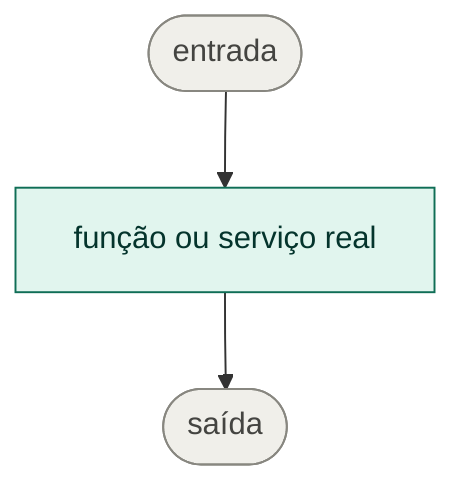

## Ticket

- Jira: ULT-___

## Contexto

<!-- Qual problema esta alteração resolve e por que ela é necessária? -->

## O que foi feito

-

## Fluxo no código

<!-- Diagrama Mermaid do plano de código que implementa a regra de negócio, com nomes reais de
funções, serviços e arquivos. Em verde, o que é novo neste PR. Se não se aplica, explique. -->

## Como testar

1.

## Evidências

<!-- Prints, GIFs, requests/responses ou logs sanitizados, quando aplicável. -->

## Riscos e mitigação

<!-- Considere API, banco, migrations, segurança, rollback, feature flag e integrações. -->

## Checklist

- [ ] Li o padrão global de back-ends e as instruções locais antes de alterar o código.
- [ ] A branch partiu de `main`; ou, se for `fix/hotfix` de produção, da última tag implantada.
- [ ] Após o último rebase/merge da branch-base, executei novamente os testes arquiteturais aplicáveis.
- [ ] Não injetei/importei repository, entidade ORM ou infraestrutura pertencente a outro módulo.
- [ ] Os baselines arquiteturais permanecem zerados; não adicionei exceção, allowlist ou supressão
      para fazer os gates passarem.
- [ ] Não introduzi `forwardRef` nem ciclo entre módulos.
- [ ] Testes necessários foram adicionados ou atualizados; caso contrário, justifiquei a ausência.
- [ ] Lint, typecheck, testes e build aplicáveis foram executados.
- [ ] A documentação foi atualizada quando necessário.
- [ ] O PR tem o diagrama Mermaid do plano de código e o mesmo diagrama está no README do módulo.
- [ ] Não deixei correção arquitetural para TODO, card ou PR posterior.
- [ ] Não foram incluídos segredos nem dados pessoais, financeiros ou de produção.
- [ ] Migrations novas foram revisadas e nenhuma migration já aplicada foi alterada.
- [ ] Alterações incompatíveis de API ou eventos foram identificadas e comunicadas.
- [ ] O plano de rollback foi considerado para mudanças de maior risco.
- [ ] Em regra de negócio de alto impacto, avaliei feature flag e registrei a decisão e a estratégia
      de ativação/rollback.
